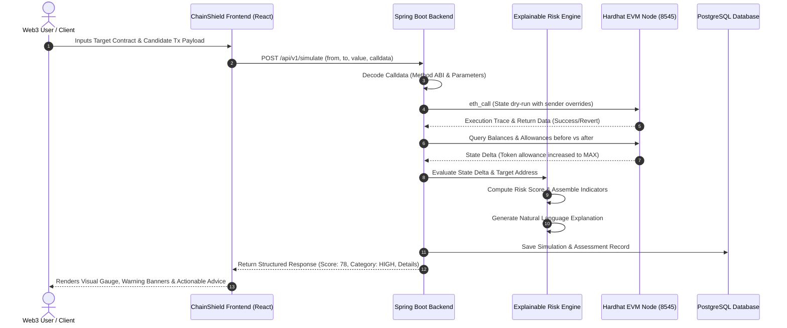
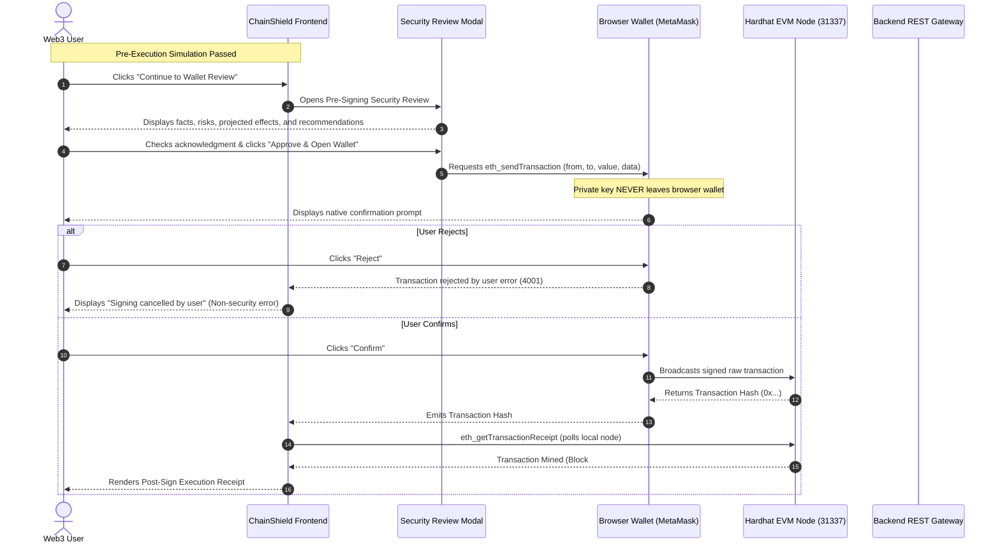
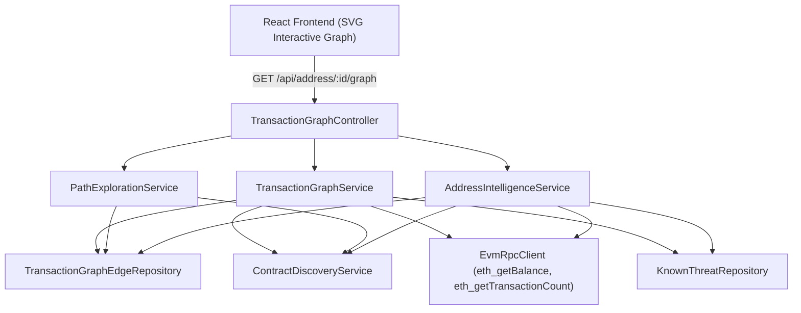

# ChainShield: System Architecture & Design Document

**Project:** ChainShield: An Explainable Blockchain-Based Cryptocurrency Transaction and Smart Contract Risk Analysis System  
**Academic Degree:** Master of Computer Applications (MCA)  
**Document Revision:** 1.2 (Milestone 7: Unified Intelligence Experience)

---

## 1. System Architecture Overview

ChainShield follows a decoupled, multi-tier enterprise architecture engineered for scalability, explainability, and local reproducibility.

```
┌─────────────────────────────────────────────────────────────────────────┐
│                          PRESENTATION TIER                              │
│  React 18 + Vite + TypeScript + Tailwind CSS + Lucide + Ethers.js       │
│  [Dashboard] [Global Search] [Investigation View] [Evidence Panel]      │
│  [Wallet Analyzer] [Contract Analyzer] [Tx Analyzer] [Forensic Graph]   │
└────────────────────────────────────┬────────────────────────────────────┘
                                     │ Centralized API Client (HTTP JSON)
                                     ▼
┌─────────────────────────────────────────────────────────────────────────┐
│                          APPLICATION TIER                               │
│           Spring Boot 3 (Java 25 LTS) Enterprise REST Service           │
│  ┌─────────────────────────┐  ┌──────────────────────────────────────┐  │
│  │ Analysis & Risk Engine  │  │ Transaction Simulation Engine        │  │
│  │ - Indicator Evaluators  │  │ - Calldata Decoder (ABI Registry)    │  │
│  │ - Scoring Algorithm    │  │ - State Delta Calculator             │  │
│  │ - Natural Language Gen  │  │ - EvmRpcClient / Web3j Client        │  │
│  └─────────────────────────┘  └──────────────────────────────────────┘  │
│  ┌─────────────────────────┐  ┌──────────────────────────────────────┐  │
│  │ Address Intelligence    │  │ Graph & History Service              │  │
│  │ - EOA / Contract Class. │  │ - Multi-Hop Topology & Paths         │  │
│  │ - Balance & Nonce Sync  │  │ - Unified Tx & Simulation History    │  │
│  └─────────────────────────┘  └──────────────────────────────────────┘  │
│  ┌─────────────────────────┐  ┌──────────────────────────────────────┐  │
│  │ Threat Intelligence Svc │  │ Dashboard Aggregation Service        │  │
│  │ - Known Malicious DB    │  │ - Real Metric Counters & Distribution│  │
│  │ - Honeypot Signatures   │  │ - Real-Time Activity Feeds           │  │
│  └─────────────────────────┘  └──────────────────────────────────────┘  │
└──────────────────┬─────────────────────────────────┬────────────────────┘
                   │ JDBC / JPA                      │ JSON-RPC (HTTP)
                   ▼                                 ▼
┌──────────────────────────────────────┐  ┌───────────────────────────────┐
│           DATA STORAGE TIER          │  │     BLOCKCHAIN / EVM TIER     │
│  PostgreSQL / H2 In-Memory Fallback  │  │  Hardhat Local EVM Node       │
│  - Entity Reputation & History       │  │  - JSON-RPC Provider (8545)   │
│  - Threat Intelligence Registry      │  │  - Test Contracts Deployed:   │
│  - Risk Assessment Audit Trail       │  │    * MockERC20 (Benign)       │
│  - Simulation Results & Graph Edges  │  │    * SafeVault (Escrow)       │
│  Flyway Schema Migrations            │  │    * DangerousApprovalSpender │
└──────────────────────────────────────┘  │    * HoneypotToken            │
                                          └───────────────────────────────┘
```

---

## 2. Component Descriptions

### 2.1 Presentation Tier (Frontend - Milestone 7 Unified Intelligence)
- **Framework:** React 18 with TypeScript and Vite for rapid HMR and optimized production bundles.
- **Centralized API Integration:** `apiClient` (`src/api/client.ts`) providing typed request handling, unified error handling (RFC 7807), and automatic timeout cancellation.
- **Unified Navigation Engine:** Parametric routing (`onNavigate(page, params)`) supporting seamless cross-module workflows without full-page reloads.
- **Shared Architectural Components:**
  - `GlobalSearch`: Instant address validation and classification (`EOA`, `CONTRACT`, `UNKNOWN`) via `/api/address/{address}/summary` with direct action buttons.
  - `EvidencePanel`: Evidence-first security presentation displaying Rule ID, Title, Severity, Weight, concrete Evidence, Why it matters, Source, and explicit Limitations.
  - `RiskScoreCard`: Consistent visual risk presentation with radial gauge, category badges, summary explanation, and defensive boundary notices.
  - `EnvironmentStatus`: Real-time tri-service health indicator (Spring Boot REST backend, Hardhat EVM RPC node, and connected Web3 wallet).
  - `AddressDisplay`: Formatted EVM address pill with 1-click clipboard copy and classification tags.
  - `SecurityReviewModal`: Enhanced pre-signing review modal strictly distinguishing `PRE-SIGN SIMULATION` (0 ETH, zero state changes) from `POST-SIGN TRANSACTION` (user approved).
  - `PostSignReceiptView`: Post-signing monitor displaying mined block number, gas used, and transaction receipt hash.

### 2.2 Application Tier (Backend Architecture - Milestone 7 Verified)
- **Framework:** Spring Boot 3.3.4 with Java 25 LTS runtime.
- **API Architecture:** RESTful gateway supporting both `/api/...` and `/api/v1/...` specifications with OpenAPI 3.0 compatibility.
- **Layered Structure:**
  1. `controller`: `DashboardController` (`/api/v1/dashboard/stats`), `RiskAnalysisController` (`/api/wallet/analyze`, `/api/contract/analyze`, `/api/transaction/analyze`, `/api/analyses`), `TransactionSimulationController` (`/api/transaction/simulate`, `/api/transactions/history`, `/api/blockchain/status`, `/api/blockchain/contracts`), `AddressIntelligenceController` (`/api/address/{address}/summary`, `/api/address/{address}/graph`), `HealthController`.
  2. `service`:
     - `DashboardService`: Aggregates real stored counts for entities, wallet/contract/tx analyses, risk distributions, and recent feeds (simulations, on-chain edges, indicators).
     - `TransactionHistoryService`: Merges on-chain graph edges and simulation records into a unified, filterable history feed.
     - `AddressIntelligenceService`: Classifies EVM accounts via RPC bytecode check, queries balances and nonces, and compiles transaction topologies.
     - `RiskAnalysisService`: Orchestrates wallet, contract, and transaction evaluations, batch-populates key indicators, and persists audit trails.
     - `TransactionSimulationService`: Orchestrates dry-run simulations, calldata decoding, and state delta calculations.
  3. `service.risk`: `DeterministicRiskEngine` (pure deterministic scoring logic, $R = \min(100, \sum (w_i \times s_i))$, explainable summary, recommendations generator, contract evaluation for `IND-C01`..`IND-C10`, simulation risk evaluation for `IND-T01`..`IND-T03`, `IND-W01`).
  4. `blockchain.client`: `EvmRpcClient` (Hardhat JSON-RPC 2.0 client: `eth_call`, `eth_estimateGas`, `eth_getCode`, `eth_getStorageAt`, `eth_getBalance`, `eth_chainId`, `eth_blockNumber`).
  6. `blockchain.registry`: `DeployedContractRegistry` (auto-discovers deployed testbed contracts from `deployed-contracts.json`).
  7. `blockchain.decoder`: `CalldataDecoder` (decodes standard ERC-20 calls `transfer`, `approve`, `transferFrom`, vault `deposit`/`withdraw`, honeypot lock/unlock, formats decimals, and flags unlimited approvals).
  8. `simulation`: `StateEffectAnalyzer` (computes projected ERC-20 balance deltas, allowance deltas, native ETH gas costs, and projected event logs).
  9. `provider`: `BlockchainDataProvider` interface with `@Primary` `HardhatBlockchainProvider` (live EVM RPC) and automatic fallback to `DemoBlockchainDataProvider` when offline.
  10. `repository`: Spring Data JPA repositories (`AnalyzedEntityRepository`, `RiskAssessmentRepository`, `RiskIndicatorRepository`, `AssessmentIndicatorRepository`, `KnownThreatRepository`, `SimulatedTransactionRepository`).
  11. `entity`: Normalized relational JPA entities corresponding to Flyway migrations.
  12. `dto`: Request/Response records (`WalletAnalysisRequest`, `ContractAnalysisRequest`, `TransactionAnalysisRequest`, `TransactionSimulationRequest`, `TransactionSimulationResponse`, `ContractAnalysisResponse`, `RiskAssessmentResponse`, `ErrorResponse`).
  13. `exception`: `GlobalExceptionHandler` delivering standard RFC 7807 problem details with field-level validation errors.


### 2.3 Blockchain Tier (Hardhat EVM Sandbox - Milestone 3 Verified)
- **Node:** Hardhat Network running locally on port `8545` (`http://127.0.0.1:8545`).
- **Chain ID:** `31337` (standard Hardhat devnet).
- **Testbed Contracts Deployed:**
  - `MockERC20`: Standard OpenZeppelin ERC-20 token (`"SHLD"`) with mint, transfer, approve.
  - `SafeVault`: Reference audited escrow smart contract exhibiting zero threat indicators.
  - `DangerousApprovalSpender`: Malicious contract simulating approval abuse and wallet draining.
  - `HoneypotToken`: Token with hidden sell restrictions and transfer locks (`"TRAP"`).
- **Deployment Script (`blockchain/scripts/deploy.js`):** Automatically pre-funds test wallet `0x70997970C51812dc3A010C7d01b50e0d17dc79C8` and exports `deployed-contracts.json` to both backend resources and frontend config.

### 2.4 Data Tier (PostgreSQL & Flyway)
- **Relational Model:** Normalized tables linking analyzed entities, historical assessments, triggered indicators, simulated transactions, and graph edges.
- **Schema Management:** Automated Flyway migrations ensuring repeatable, version-controlled database provisioning.
- **Dual-Profile Support:**
  - `prod` / `dev-postgres`: Connects to local PostgreSQL instance.
  - `dev-h2`: In-memory H2 database fallback for environments where PostgreSQL is not yet running, ensuring 100% zero-blocker local execution.

---

## 3. Sequence & Data Flow Diagrams

### 3.1 Transaction Simulation & Explainability Workflow



### 3.2 User-Controlled Transaction Execution & Post-Signing Flow (Milestone 4)



---

## 4. Security Architecture & Ethical Guidelines

1. **Non-Custodial Design:** ChainShield never requires, solicits, accepts, stores, displays, transmits, or logs private keys or mnemonic seed phrases. All transaction simulations are executed via read-only `eth_call` RPC methods. When a user chooses to execute a local demo transaction, signing is delegated entirely to the user's browser wallet via EIP-1193 standard calls.
2. **User-Controlled Transaction Execution:** The application *never* broadcasts transactions autonomously. Execution requires explicit confirmation in the ChainShield Security Review Modal followed by signature approval in the browser wallet.
3. **Network Boundary Enforcement:** Live transaction execution is restricted to the local Hardhat demo sandbox (Chain ID 31337). If an unsupported network is detected, warnings are displayed and network switching is requested via standard `wallet_switchEthereumChain` without silent alterations.
4. **Input Sanitization & Normalization:** All address strings are strictly validated using regular expressions (`^0x[0-9a-fA-F]{40}$`) and converted to standard EIP-55 checksum format before processing.
5. **CORS & Rate Limiting:** Backend restricts cross-origin access to authorized frontend origins and protects analytical endpoints with configurable rate limits.
6. **Environment Isolation:** All RPC endpoints, database credentials, and service ports are managed via `.env` configuration with secure defaults and zero committed secrets.

> [!IMPORTANT]
> **PROTOTYPE SECURITY DISCLAIMER:**  
> *"ChainShield is a prototype security-analysis system. Its risk assessment is not a guarantee that a transaction or contract is safe or malicious."*

---

## 5. Forensic Transaction Graph & Address Intelligence Architecture (Milestone 6)

The Forensic Transaction Graph subsystem enables multi-hop on-chain relationship inspection, token flow tracing, and evidence-grounded threat detection across accounts.



### 5.1 Architecture Principles
1. **Bounded Graph Expansion:** Traversal depth is clamped to 1–3, with hard caps of 50 nodes and 100 edges to prevent memory exhaustion and RPC timeouts.
2. **Cycle Safety:** Visited set tracking in BFS traversal prevents infinite loops in bidirectional relationships.
3. **Evidence-Based Threat Overlay:** A node connection to a suspicious entity does NOT inherit a malicious label. Only explicit rules matching local threat feeds or prior high-risk assessments produce indicator flags.
4. **Deterministic Local Grounding:** Relies strictly on reproducible local Hardhat blocks, deployed contracts, and database records.


