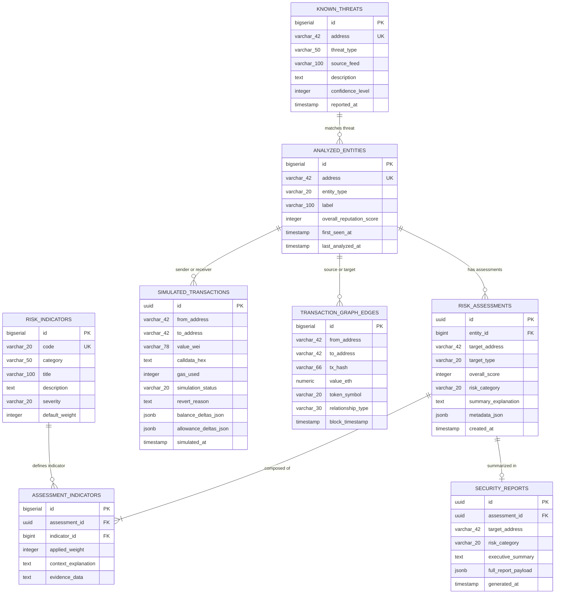

# ChainShield: Database Design & Schema Specification

**Project:** ChainShield: An Explainable Blockchain-Based Cryptocurrency Transaction and Smart Contract Risk Analysis System  
**Academic Degree:** Master of Computer Applications (MCA)  
**Database Engines:** PostgreSQL 15+ (Primary Production Profile) / H2 In-Memory (Zero-Dependency Dev Fallback)  
**Migration Tool:** Flyway Database Migrations

---

## 1. Entity-Relationship (ER) Conceptual Model

---

## 2. Table Schemas & Data Dictionary

### 2.1 Table: `analyzed_entities`
Stores tracked EVM addresses (wallets or contracts) and aggregate reputation records.

| Column | Type | Constraints | Description |
| :--- | :--- | :--- | :--- |
| `id` | `BIGSERIAL` | `PRIMARY KEY` | Unique surrogate key. |
| `address` | `VARCHAR(42)` | `NOT NULL, UNIQUE` | Standard EIP-55 42-char hex address. |
| `entity_type` | `VARCHAR(20)` | `NOT NULL` | `WALLET`, `CONTRACT`, or `UNKNOWN`. |
| `label` | `VARCHAR(100)` | `NULLABLE` | Human-friendly tag (e.g. "Mock Honeypot", "Uniswap V2 Pair"). |
| `overall_reputation_score` | `INTEGER` | `NOT NULL DEFAULT 0` | Historical composite score (0–100). |
| `first_seen_at` | `TIMESTAMP` | `NOT NULL` | Timestamp when first recorded. |
| `last_analyzed_at` | `TIMESTAMP` | `NOT NULL` | Timestamp of latest evaluation. |

### 2.2 Table: `risk_assessments`
Records every executed risk assessment session with overall scoring and summary.

| Column | Type | Constraints | Description |
| :--- | :--- | :--- | :--- |
| `id` | `UUID` | `PRIMARY KEY` | Globally unique identifier. |
| `entity_id` | `BIGINT` | `REFERENCES analyzed_entities(id)` | Target entity reference. |
| `target_address` | `VARCHAR(42)` | `NOT NULL` | EIP-55 address evaluated. |
| `target_type` | `VARCHAR(20)` | `NOT NULL` | `WALLET`, `CONTRACT`, or `TRANSACTION`. |
| `overall_score` | `INTEGER` | `NOT NULL` | Final computed score (0–100). |
| `risk_category` | `VARCHAR(20)` | `NOT NULL` | `LOW`, `MEDIUM`, `HIGH`, or `CRITICAL`. |
| `summary_explanation` | `TEXT` | `NOT NULL` | Generated natural language summary. |
| `metadata_json` | `TEXT / JSONB` | `NULLABLE` | Raw metrics, gas info, and extra flags. |
| `created_at` | `TIMESTAMP` | `NOT NULL` | Assessment completion timestamp. |

### 2.3 Table: `risk_indicators`
Catalog of all security risk rules and heuristic definitions evaluated by the risk engine.

| Column | Type | Constraints | Description |
| :--- | :--- | :--- | :--- |
| `id` | `BIGSERIAL` | `PRIMARY KEY` | Unique indicator ID. |
| `code` | `VARCHAR(20)` | `NOT NULL, UNIQUE` | Unique indicator identifier (e.g. `IND-W01`). |
| `category` | `VARCHAR(50)` | `NOT NULL` | `WALLET_BEHAVIOR`, `CONTRACT_PERMISSIONS`, `SIMULATION_DELTA`. |
| `title` | `VARCHAR(100)` | `NOT NULL` | Concise name of the indicator. |
| `description` | `TEXT` | `NOT NULL` | Detailed explanation of what the rule detects. |
| `severity` | `VARCHAR(20)` | `NOT NULL` | `INFO`, `LOW`, `MEDIUM`, `HIGH`, `CRITICAL`. |
| `default_weight` | `INTEGER` | `NOT NULL` | Base point impact in scoring formula (0–50). |

### 2.4 Table: `assessment_indicators`
Junction table linking specific risk assessments to the concrete indicators triggered during execution.

| Column | Type | Constraints | Description |
| :--- | :--- | :--- | :--- |
| `id` | `BIGSERIAL` | `PRIMARY KEY` | Unique row identifier. |
| `assessment_id` | `UUID` | `REFERENCES risk_assessments(id) ON DELETE CASCADE` | Parent assessment. |
| `indicator_id` | `BIGINT` | `REFERENCES risk_indicators(id)` | Triggered rule definition. |
| `applied_weight` | `INTEGER` | `NOT NULL` | Effective weight after modifiers. |
| `context_explanation` | `TEXT` | `NOT NULL` | Dynamic reasoning specific to this target. |
| `evidence_data` | `TEXT` | `NULLABLE` | Concrete transaction hashes, opcodes, or balances. |

### 2.5 Table: `simulated_transactions`
Stores safe dry-run transactions and their projected state changes.

| Column | Type | Constraints | Description |
| :--- | :--- | :--- | :--- |
| `id` | `UUID` | `PRIMARY KEY` | Simulation UUID. |
| `from_address` | `VARCHAR(42)` | `NOT NULL` | Sender address. |
| `to_address` | `VARCHAR(42)` | `NOT NULL` | Target contract/wallet address. |
| `value_wei` | `VARCHAR(78)` | `NOT NULL DEFAULT '0'` | Value in Wei (supports up to $2^{256}-1$). |
| `calldata_hex` | `TEXT` | `NULLABLE` | Raw hexadecimal input data. |
| `gas_used` | `INTEGER` | `NULLABLE` | Simulated gas consumption. |
| `simulation_status` | `VARCHAR(20)` | `NOT NULL` | `SUCCESS`, `REVERTED`, or `FAILED`. |
| `revert_reason` | `TEXT` | `NULLABLE` | Decoded revert error message if reverted. |
| `balance_deltas_json` | `TEXT / JSONB` | `NULLABLE` | Projected native and ERC-20 balance deltas. |
| `allowance_deltas_json` | `TEXT / JSONB` | `NULLABLE` | Projected token allowance modifications. |
| `simulated_at` | `TIMESTAMP` | `NOT NULL` | Simulation execution timestamp. |

### 2.6 Table: `known_threats`
Deterministic local threat intelligence database containing known malicious addresses and patterns.

| Column | Type | Constraints | Description |
| :--- | :--- | :--- | :--- |
| `id` | `BIGSERIAL` | `PRIMARY KEY` | Threat entry ID. |
| `address` | `VARCHAR(42)` | `NOT NULL, UNIQUE` | Malicious EVM address. |
| `threat_type` | `VARCHAR(50)` | `NOT NULL` | `PHISHING_DRAINER`, `HONEYPOT`, `MIXER`, `RANSOMWARE`. |
| `source_feed` | `VARCHAR(100)` | `NOT NULL` | Feed or local dataset label. |
| `description` | `TEXT` | `NOT NULL` | Context on threat behavior. |
| `confidence_level` | `INTEGER` | `NOT NULL DEFAULT 100` | Confidence percentage (0–100). |
| `reported_at` | `TIMESTAMP` | `NOT NULL` | Discovery date. |

### 2.7 Table: `transaction_graph_edges`
Topological graph records for visualizing fund, token transfer, and contract interaction flows between entities.

| Column | Type | Constraints | Description |
| :--- | :--- | :--- | :--- |
| `id` | `BIGSERIAL` | `PRIMARY KEY` | Edge ID. |
| `from_address` | `VARCHAR(42)` | `NOT NULL` | Source address node. |
| `to_address` | `VARCHAR(42)` | `NOT NULL` | Destination address node. |
| `tx_hash` | `VARCHAR(66)` | `NOT NULL` | Unique transaction hash. |
| `value_eth` | `NUMERIC(18, 6)`| `NOT NULL DEFAULT 0` | Transferred value in native ETH. |
| `token_symbol` | `VARCHAR(20)` | `NOT NULL DEFAULT 'ETH'` | Asset symbol. |
| `relationship_type`| `VARCHAR(30)` | `NOT NULL` | `SENT_NATIVE`, `RECEIVED_NATIVE`, `TOKEN_TRANSFER`, `CONTRACT_INTERACTION`. |
| `block_timestamp` | `TIMESTAMP` | `NOT NULL` | Block execution time. |
| `block_number` | `BIGINT` | `DEFAULT 0` | Mined block number on EVM chain. |
| `token_address` | `VARCHAR(42)` | `NULLABLE` | ERC-20 contract address if token transfer. |
| `token_amount` | `VARCHAR(78)` | `NULLABLE` | Raw or formatted token transfer quantity. |
| `function_name` | `VARCHAR(100)` | `NULLABLE` | Decoded method name if contract interaction. |
| `network` | `VARCHAR(50)` | `DEFAULT 'LOCAL_DEMO_NETWORK'` | Network identifier. |

### 2.8 Table: `security_reports`
Exportable security assessment audits and reports.

| Column | Type | Constraints | Description |
| :--- | :--- | :--- | :--- |
| `id` | `UUID` | `PRIMARY KEY` | Unique report identifier. |
| `assessment_id` | `UUID` | `REFERENCES risk_assessments(id)` | Linked assessment. |
| `target_address` | `VARCHAR(42)` | `NOT NULL` | Evaluated target. |
| `risk_category` | `VARCHAR(20)` | `NOT NULL` | Composite risk tier. |
| `executive_summary`| `TEXT` | `NOT NULL` | Executive summary for non-technical stakeholders. |
| `full_report_payload`| `TEXT / JSONB` | `NOT NULL` | Complete serialized audit payload for export/print. |
| `generated_at` | `TIMESTAMP` | `NOT NULL` | Report generation timestamp. |

---

## 3. Database Indexes

To maintain sub-second response times ($\le 1.5\text{s}$), the following indexes are specified:
1. `idx_entities_address`: `CREATE INDEX ON analyzed_entities(address);`
2. `idx_assessments_address`: `CREATE INDEX ON risk_assessments(target_address);`
3. `idx_assessments_created`: `CREATE INDEX ON risk_assessments(created_at DESC);`
4. `idx_known_threats_address`: `CREATE INDEX ON known_threats(address);`
5. `idx_graph_from`: `CREATE INDEX ON transaction_graph_edges(from_address);`
6. `idx_graph_to`: `CREATE INDEX ON transaction_graph_edges(to_address);`
7. `idx_sim_from_to`: `CREATE INDEX ON simulated_transactions(from_address, to_address);`

---

## 4. Flyway Migration Versioning & Milestone 2 Verification

Database migrations are located in `backend/src/main/resources/db/migration/`:

### 4.1 Implemented Migrations
1. `V1__init_schema.sql`:
   - Creates the 8 core tables: `analyzed_entities`, `risk_indicators`, `risk_assessments`, `assessment_indicators`, `simulated_transactions`, `known_threats`, `transaction_graph_edges`, and `security_reports`.
   - Creates foreign key constraints with `ON DELETE CASCADE` where appropriate.
   - Adds indexes for `address`, `target_address`, `created_at DESC`, `from_address`, and `to_address`.
2. `V2__seed_threat_data.sql`:
   - Seeds 10 base risk indicators (`IND-W01` to `IND-W03`, `IND-C01` to `IND-C04`, `IND-T01` to `IND-T03`).
   - Seeds local synthetic threat intelligence records for Hardhat testbed demonstrations:
     - `0x3c44cdddb6a900fa2b585dd299e03d12fa4293bc` (Simulated Privacy Mixer)
     - `0x90f79bf6eb2c4f870365e785982e1f101e93b906` (Simulated Phishing Drainer)
     - `0x5fbdb2315678afecb367f032d93f642f64180aa3` (Honeypot Token Contract)
     - `0xe7f1725e7734ce288f8367e1bb143e90bb3f0512` (Dangerous Approval Spender)
3. `V3__contract_analysis_features.sql`:
   - Adds smart contract security analysis indexes and audit metadata tracking.
4. `V4__graph_and_intelligence.sql`:
   - Adds `block_number`, `token_address`, `token_amount`, `function_name`, and `network` to `transaction_graph_edges`.
   - Adds high-performance forensic query indexes:
     - `idx_graph_tx_hash`: `CREATE INDEX ON transaction_graph_edges(tx_hash);`
     - `idx_graph_block`: `CREATE INDEX ON transaction_graph_edges(block_number);`
     - `idx_graph_token`: `CREATE INDEX ON transaction_graph_edges(token_address);`
     - `idx_graph_rel_type`: `CREATE INDEX ON transaction_graph_edges(relationship_type);`

### 4.2 Runtime Profile Configuration & Credential Safety
- **Local Dev Profile (`dev-h2`)**: Active by default. Runs an in-memory H2 database (`jdbc:h2:mem:chainshield_db`) with full ANSI SQL Flyway migrations executing on startup. H2 Web Console available at `http://localhost:8080/h2-console`.
- **Production Profile (`dev-postgres`)**: Configured for PostgreSQL 15+. Activated via `SPRING_PROFILES_ACTIVE=dev-postgres`. Reads connection parameters from environment variables (`POSTGRES_HOST`, `POSTGRES_PORT`, `POSTGRES_DB`, `POSTGRES_USER`, `POSTGRES_PASSWORD`).
- **Credential Safety**: No database passwords or master credentials are hardcoded into version control.
- **Schema Validation**: `spring.jpa.hibernate.ddl-auto=validate` enforces that Flyway is the sole authoritative source of truth for schema management.
